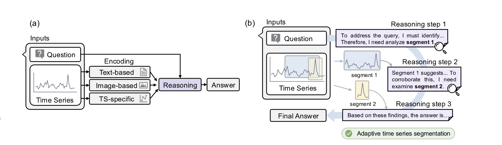
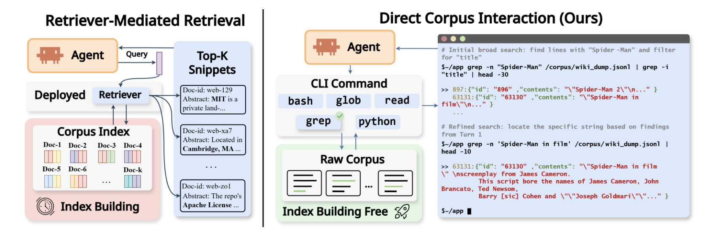
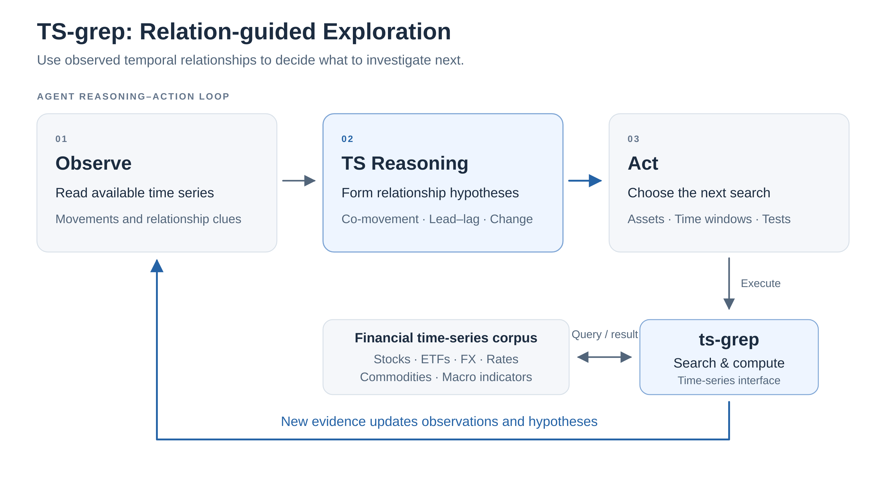
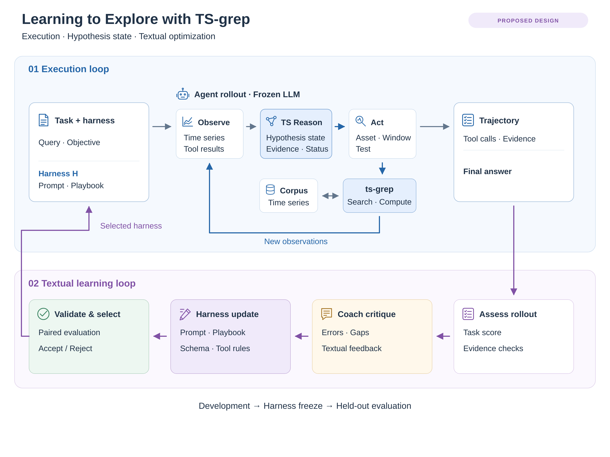

# 주제 1: 시계열 간 관계 추론에 기반한 금융 데이터 탐색 에이전트

## Motivation — 시계열의 관계를 바탕으로 필요한 정보를 탐색할 수 있어야 한다

- **핵심 질문:** 사전 지식에 기반한 탐색을 넘어, **시계열에서 관측되는 시간적 관계가 다음 탐색 행동을 이끄는 Agent를 만들 수 있을까?**

  즉, **알고 있는 관계를 따라 탐색하는 것에서, 데이터에서 발견한 관계를 따라 탐색하는 것으로 확장**하는 방향임.

- **금융에서의 필요성:** 한 자산의 움직임을 이해하기 위해 다른 종목·금리·환율 등과의 관계를 함께 살펴봐야 함. 하지만 어떤 자산이 관련 있는지, 그 관계가 어느 기간에 유효한지는 미리 알기 어렵고 시간에 따라 달라짐.
- **기존 탐색 방식:** 일반적인 텍스트 중심 Agent는 `observe → reasoning → act` 과정에서 도메인 지식과 텍스트 단서를 바탕으로 다음 탐색을 결정함.

  - 예: 반도체 기업의 주가가 하락하면 기업명이나 업종과 관련된 뉴스를 검색함.

- **확인하려는 가능성:** 사전 지식 기반 탐색 대상이 현재 시장에서 실제로 중요한 대상과 다를 수 있음.
- **연구의 초점:** 관련 대상을 찾는 탐색과 시계열 관계에 대한 추론을 연결함.

## Previous Work — 기존 연구의 관찰과 우리 연구로의 연결

| 핵심 관찰 | 관련 연구의 시사점 | 우리 연구로의 연결·가설 |
| --- | --- | --- |
| **검토한 TS 추론 연구는 단일 시계열 또는 주어진 종목 쌍의 분석에 집중함** | **[ReasonCast](https://arxiv.org/html/2608.01875):** 단변량의 5개 기본 패턴으로 벤치마크 구성. 다변량 확장은 향후 과제임. **[ARTIST](https://arxiv.org/html/2602.18645v3):** 단변량 시계열 과제로 평가함. **[FinSTaR](https://arxiv.org/html/2605.03460v5):** Multi는 주어진 두 종목의 Correlation / Relative Performance / Pair Convergence 3과제이며, 데이터는 S&P 500 시가총액 상위 250종목으로 구성함. | 주어진 대상을 분석하는 것을 넘어, **N개 시계열 중 관련 대상 자체를 Agent가 찾아내며 관계를 추론하는 탐색 문제**로 확장하고자 함. |
| **추론과 ‘어디를 볼지’의 선택을 번갈아 수행하는 방식이 유효함** | **[ARTIST](https://arxiv.org/html/2602.18645v3):** 시계열 전체를 정적으로 제공하기보다, **질문에 필요한 구간을 선택하며 추론하는 방식이 효과적일 수 있음**을 보여줌. | 탐색 행동 학습의 선행 근거임. |
| **검색 인터페이스의 해상도가 증거 활용과 성능에 영향을 줌** | **[DCI](https://arxiv.org/html/2605.05242):** 고정된 검색 결과를 받는 것을 넘어, **원문을 직접 검색하고 세부 증거를 확인할 수 있는 인터페이스가 Agent의 증거 활용을 개선할 수 있음**을 보여줌. | 단순 문서 발견뿐 아니라 **도달한 증거를 좁혀 살펴보고 활용하는 능력**이 중요함. 시계열에서도 고정 표현이 구조적 단서를 잃을 수 있다는 가설 아래, 세밀한 검색·계산을 지원하는 `ts-grep`을 검토함. |

ARTIST — 핵심 Figure: 필요한 구간을 선택하며 추론

출처: [ARTIST](https://arxiv.org/html/2602.18645v3)

DCI — 핵심 Figure: Corpus 직접 탐색

출처: [Direct Corpus Interaction](https://arxiv.org/html/2605.05242)

## Proposed method — TS-grep (`observe → TS-reasoning → act`)

- **핵심 방법:** 기존 Agent의 추론 과정에 선행·후행, 동조, 관계의 변화 등 다중 시계열 구조에 대한 추론을 명시적으로 도입하여, 시계열에서 발견한 관계가 다음 탐색 행동을 이끌도록 함.

- **Observe:** 현재 확보한 시계열에서 움직임과 관계에 관한 단서를 관측함.
- **TS-reasoning:** “여러 자산이 공통 요인에 반응했는가?”, “어떤 자산이 먼저 움직였는가?”, “기존 관계가 언제부터 달라졌는가?”와 같은 가설을 세움.
- **Act:** 가설을 확인하거나 반박할 수 있는 자산·기간·통계량을 선택하고, `ts-grep`으로 추가 정보를 탐색함.

  - 예: 업종 내 여러 종목의 동반 하락을 관측 → 공통 요인 가능성 추론 → 직전에 먼저 움직인 해외 지수·환율 검색 → 다른 기간에서도 관계가 반복되는지 검증.

- **탐색 인터페이스:** 이러한 탐색을 지원하는 시계열 전용 검색·계산 인터페이스로서 `ts-grep`을 제안함.
- **피드백:** Agent는 관계 가설과 검증 상태를 기록하고, 새로운 결과에 따라 가설과 다음 행동을 수정함. 실행 피드백으로 프롬프트와 탐색 지침을 개선함.

## 학습 과정 — 실행 피드백으로 탐색 지침을 개선

**Agent의 실행 기록을 평가하고, 다음 탐색을 이끄는 텍스트 지침을 반복적으로 수정하는 학습 구조를 제안함.** 아래는 모델 가중치 학습이 아닌 프롬프트·탐색 지침 개선의 설계안임.

- **실행 루프:** 질문과 현재 탐색 지침을 받은 Agent가 `Observe → TS-reasoning → Act`를 반복함. `ts-grep`의 검색·계산 결과로 가설을 수정하고, Tool 호출·결과와 최종 답변을 기록함.
- **학습 루프:** 과제의 기준 답안·검증 조건과 Tool 근거로 실행 결과를 점검함. LLM이 부족했던 탐색·검증을 텍스트 피드백으로 정리하고 지침 수정안을 생성함. 개발 과제에서 기존·수정 지침을 재실행·비교하여 다음 지침을 선택함. 개발 후에는 지침을 고정하고 별도 평가 과제에 적용함.
- **가설 상태(Hypothesis state):** 현재 과제에서 조사 중인 관계 후보·근거·검증 상태를 관리하고, 다음에 확인할 자산·기간·검사를 선택하는 작업 상태임. 과제 간에 개선하는 프롬프트·탐색 지침과는 구분함.

## Dataset 구성 — 다중 금융 시계열을 탐색 가능한 corpus로 구성

- **데이터원:** FinVerse의 주식·ETF·지수·금리·환율·원자재·거시지표 등을 활용하는 계획임.
- **Corpus:** 주식·ETF·금리·환율·원자재·거시지표 등 다양한 시계열을 모아, 자산·기간·수치 조건으로 검색할 수 있도록 구성함.
- **규모:** 시계열 수를 50 → 500 → 5,000개 등으로 늘려 탐색 난이도와 비용을 비교하는 구상임.
- **평가 데이터:** 관계를 의도적으로 심은 합성 데이터와 ETF–구성종목 등 연결이 알려진 실제 데이터를 사용함.

## Application — 관련 자산 발견과 금융 관계 분석

| 과제 | 구성 방식 | 확인하려는 능력 |
| --- | --- | --- |
| **합성 구조 발견 — 주력** | 여러 시계열 사이에 선행·후행, 동조, 관계 변화 등을 심고 무관한 시계열을 섞음. 심은 관계와 기간을 정답으로 사용함. | 관련 대상을 직접 찾고, 관계 유형·방향·유효 기간까지 발견하는가? |
| **실제 데이터의 알려진 연결 탐색** | ETF–구성종목, ADR–원주, 선물–현물 등 연결이 알려진 대상을 corpus에 포함함. | 실제 데이터에서도 연결된 대상과 관계가 달라지는 구간을 찾아내는가? |
| **시장 이벤트 분석** | 특정 자산의 움직임이 여러 자산에 공통으로 나타났는지, 개별적으로 나타났는지 조사하게 함. | 관측한 관계를 바탕으로 조사할 사건·자산·기간을 선택하는가? |
| **예측·의사결정으로 확장** | 제한된 탐색 예산 안에서 관련 시계열을 찾아 예측이나 자산 선택에 활용함. | 발견한 관계가 후속 과제에도 도움이 되는가? |

## Contribution — 시계열 관계 추론이 Agent의 탐색 행동을 이끄는 방법

**시계열의 관계를 바탕으로 필요한 정보를 탐색할 수 있어야 한다**

- **Agent 구조:** 여러 시계열의 관계를 명시적인 가설로 관리하고, 이를 근거로 다음에 볼 자산·기간·검사를 선택하는 Agent 구조를 제안함.
- **탐색 범위 확장:** 주어진 시계열 내부에서 여러 자산과 그 관계로 탐색 범위를 확장함.
- **탐색·평가 기반:** 이를 지원하는 `ts-grep` 인터페이스와 관계 발견 벤치마크를 구축함.
